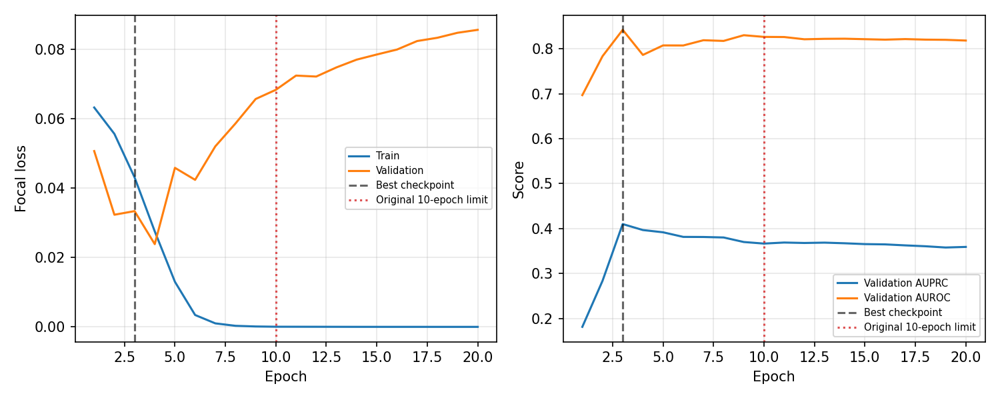
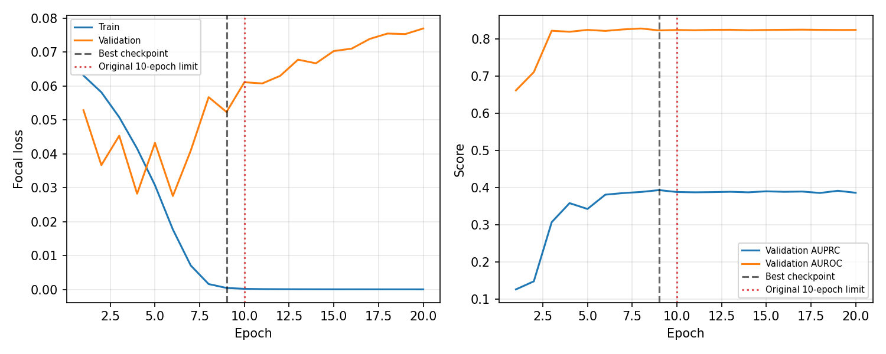
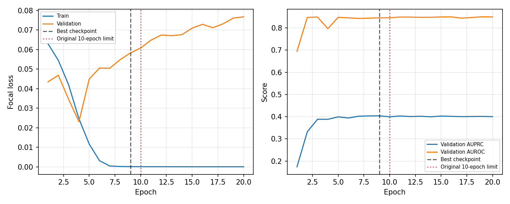
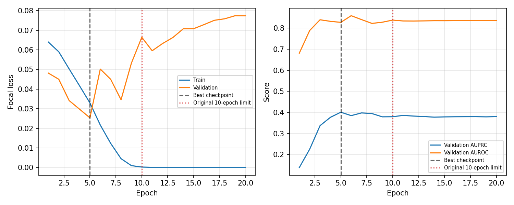
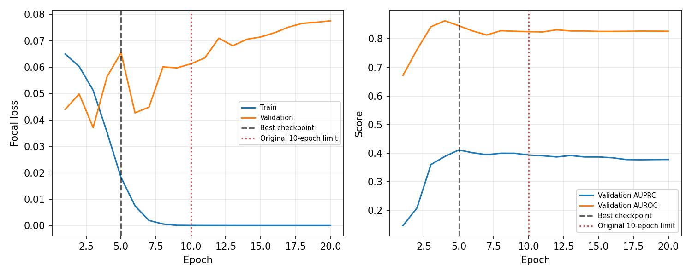
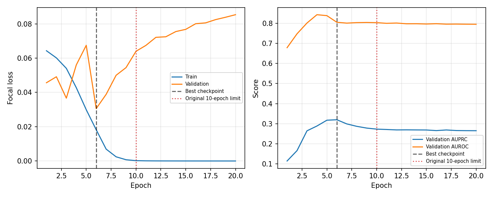

# Supplementary experiment: training duration verification

*Added after instructor feedback, November 2026.*

This experiment was added after feedback that the final models had been trained for only ten epochs and that their validation curves had not settled. It checks whether continuing the same training setup would select a better validation checkpoint after epoch 10. The original final models and held-out test results remain the primary project comparison.

## Protocol

- Models: CC-only ResNet50 and CC+MLO two-branch ResNet50 with concatenation.
- Seeds: 42, 21 and 10; the original train and validation breast-pair splits were reused.
- Preprocessing and optimization: 512 × 512 input, focal loss, Adam, physical batch size 1 with gradient accumulation to an effective batch of 8, fixed encoder learning rate 1 × 10⁻⁵ and classifier learning rate 1 × 10⁻⁴. Only the final residual block and classifier were trainable; BatchNorm statistics remained fixed.
- Four data-loader workers accelerated image loading. Each fresh run was required to complete at least 20 epochs, with a maximum of 30. The checkpoint with the highest validation AUPRC was saved. Early stopping used patience 8 and a minimum meaningful gain of 0.002, but did not stop a run before epoch 20.
- The held-out test set was not evaluated in this supplementary experiment.

Run from the project root after making the image paths in `data/splits/` valid:

```powershell
python scripts/train_stability_experiment.py --model both --seeds 42 21 10 --batch-size 1 --workers 4 --fixed-lr --min-epochs 20 --max-epochs 30
```

## Validation results

All six runs completed 20 epochs and stopped. The third numeric column below is the highest AUPRC *within epochs 11–20 of the same fresh run*; it directly tests whether the extra epochs surpassed the earlier checkpoint.

| Seed | Model | Original 10-epoch run: best AUPRC (epoch) | Fresh 20-epoch run: best AUPRC (epoch) | Fresh run, epochs 11–20: best AUPRC (epoch) |
| ---: | --- | ---: | ---: | ---: |
| 42 | CC+MLO | 0.4091 (4) | 0.4100 (3) | 0.3689 (11) |
| 42 | CC-only | 0.3735 (10) | 0.3936 (9) | 0.3918 (19) |
| 21 | CC+MLO | 0.4417 (7) | 0.4037 (9) | 0.4030 (11) |
| 21 | CC-only | 0.4049 (7) | 0.4010 (5) | 0.3858 (11) |
| 10 | CC+MLO | 0.3923 (5) | 0.4111 (5) | 0.3916 (13) |
| 10 | CC-only | 0.3574 (5) | 0.3197 (6) | 0.2712 (11) |

The best validation AUPRC occurred at epochs 3–9 in all six fresh runs. None of the epochs 11–20 surpassed the best earlier checkpoint. Training loss approached zero while validation loss rose, consistent with overfitting under this setup. The validation AUPRC curves need not become smooth for the best checkpoint to be selected.

The absolute scores differ between the original ten-epoch runs and these fresh runs. They are separate optimizations, not continuations of the original optimizer state, so the differences between those runs should not be attributed to the extra epochs. Four data-loader workers were used in the supplementary runs, versus zero in the original final runs. With only 57 positive validation breast pairs, AUPRC is also sensitive to ranking changes. This experiment gives empirical evidence against a gain from epochs 11–20 in these runs; it does not establish that every later epoch or another training schedule would fail to improve.

## Training curves

Each figure shows focal loss on the left and validation AUPRC/AUROC on the right. The black dashed line marks the selected checkpoint; the red dotted line marks the original ten-epoch limit. The fixed learning rates are stated in the protocol and omitted from the figures.

### Seed 42





### Seed 21





### Seed 10





Per-epoch histories and the machine-readable summary are in `results/training_stability/`. Supplementary best checkpoints are in `models/training_stability/`.
